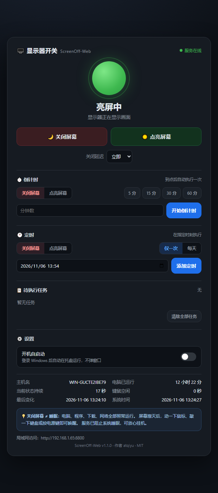

# ScreenOff-Web

局域网网页控制 Windows 显示器亮灭 —— **只关屏幕，电脑照常运行**。

装好后无主窗口、无控制台，常驻 Windows 系统托盘；用手机或另一台电脑连同一 Wi‑Fi，
打开网页即可查看屏幕状态、开关显示器、设置**倒计时**与**定时**任务。



## 特性

- **托盘常驻，静默运行**：无控制台、无主界面，点击托盘图标打开菜单
- **网页控制**：查看亮屏/灭屏状态、一键开关、延迟关屏
- **倒计时**：N 分钟后关闭或点亮屏幕（5/15/30/60 分钟快捷选项）
- **定时任务**：指定日期时间执行一次，或每天固定时刻执行；任务可取消、可持久化
- **开机自启动**：托盘菜单和网页设置里都能一键开关
- **电脑不睡眠**：`SetThreadExecutionState(ES_SYSTEM_REQUIRED)` 阻止系统睡眠
- **状态检测三层兜底**：系统电源通知 → 键鼠活动 → 自身命令
- **零外部依赖**：exe 已内置 Python 运行环境，目标电脑无需安装任何东西
- **可选访问口令**：`--token`，适合不完全可信的局域网

## 下载安装

两种方式，任选其一：

| 方式 | 文件 | 说明 |
|---|---|---|
| **MSI 安装包（推荐）** | `ScreenOffWeb-1.1.0.msi` | 安装到 `Program Files\ScreenOff-Web`，创建桌面/开始菜单快捷方式，自动放行 TCP 8800 |
| **绿色版** | `ScreenOffWeb.exe` | 单文件，双击即用，无需安装 |

> 程序未做代码签名，Windows SmartScreen 可能提示"未知发布者"：
> 点「更多信息 → 仍要运行」即可。

安装完成后从开始菜单或桌面启动 **ScreenOff-Web**。首次启动会打开控制面板网页，
之后它只待在托盘里。

## 使用

### 托盘图标

左键双击或菜单「打开控制面板」→ 浏览器打开网页。菜单还包含：

- 当前屏幕状态、局域网地址（点击可打开网页 / 复制地址）
- **状态详情**：屏幕状态、运行时长、任务数量、配置文件位置
- **开机自启动**：勾选即写入 `HKCU\...\Run`，登录后静默启动
- **允许防火墙访问**：为当前端口放行入站（UAC 提权）
- **打开数据文件夹**、**关于**、**退出**

### 网页

启动后控制台/托盘提示局域网地址，例如 `http://192.168.1.5:8800`。

- 顶部：当前屏幕状态、关闭 / 点亮按钮、可选的关闭延迟
- **倒计时**：选动作（关屏/点亮）→ 填分钟数或点快捷按钮 → 开始
- **定时**：选动作 → 「仅一次」选日期时间 / 「每天」选时刻 → 添加
- **待执行任务**：显示剩余时间，✕ 可取消，支持清除全部
- **设置**：开机自启动开关

### 开机自启动

两处均可设置，效果相同：托盘菜单「开机自启动」勾选项、网页「设置」开关。
开启后，登录 Windows 时程序以 `--no-open` 参数静默启动，不弹网页、不弹窗口。

## 命令行参数

```bat
ScreenOffWeb.exe                    :: 托盘模式（默认）
ScreenOffWeb.exe --no-open          :: 托盘模式且不自动打开网页（自启动用）
python server.py --port 9000        :: 开发模式：带控制台的网页服务
python server.py --token 123456     :: 启用访问口令
```

配置文件位于 `%APPDATA%\ScreenOff-Web\config.json`：

```json
{
  "port": 8800,
  "token": "",
  "last_port": 8800,
  "open_browser": true
}
```

任务保存在同目录 `tasks.json`，日志在 `app.log`。

## HTTP 接口

| 方法 | 路径 | 作用 |
|---|---|---|
| GET | `/api/status` | 屏幕状态、任务摘要、自启动、开机时长等 |
| GET | `/api/tasks` | 任务列表与最近执行历史 |
| POST | `/api/screen/off` | 关闭显示器 |
| POST | `/api/screen/on` | 点亮显示器 |
| POST | `/api/toggle` | 反转当前状态 |
| POST | `/api/tasks` | 新建任务（见下） |
| DELETE | `/api/tasks/{id}` | 删除任务 |
| POST | `/api/tasks/clear` | 清除全部任务 |
| POST | `/api/autostart` | `{"enabled": true}` 设置开机自启 |

新建任务请求体：

```json
{"mode": "countdown", "action": "off", "seconds": 1800}
{"mode": "once",      "action": "on",  "at": "2026-11-06T22:30"}
{"mode": "daily",     "action": "off", "time": "23:00"}
```

有口令时在 URL 加 `?token=...`，或请求头 `X-Token`。

## 工作原理

**关屏 / 开屏**：向所有可见顶层窗口与广播句柄发送 `WM_SYSCOMMAND` + `SC_MONITORPOWER`
（`2` 灭屏、`-1` 点亮）；开屏时附带一次 1 像素的鼠标往返移动确保唤醒。

**状态判断**：

1. 系统电源通知 `GUID_MONITOR_POWER_ON` / `GUID_CONSOLE_DISPLAY_STATE`；
2. 灭屏后 `GetLastInputInfo` 一旦变化 → 屏幕必然已亮；
3. 本程序发出的开/关命令。

**不睡眠**：服务运行期间调用 `SetThreadExecutionState(ES_CONTINUOUS | ES_SYSTEM_REQUIRED)`，
Windows 不会进入睡眠/休眠，显示器熄灭不受影响。

**定时任务**：后台线程每 0.5 秒检查到期任务，执行后写入历史；每日任务自动排到下一天。
应用关闭期间过期的一次性任务不会补执行（避免开机即关屏）。

## 构建

```bat
pip install pyinstaller pystray pillow
python build.py            :: 生成 dist\ScreenOffWeb.exe 与 dist\ScreenOffWeb-1.1.0.msi
python build.py exe        :: 只构建 exe
python build.py msi        :: 只构建 msi
```

MSI 由 WiX Toolset v3.14 构建。把 `wix314-binaries.zip` 解压到 `tools\wix314\` 即可；
`build.py` 会调用其中的 `candle.exe` / `light.exe`。

## 项目结构

```
ScreenOff-Web/
├─ app.py                 托盘应用入口（无控制台）
├─ server.py              HTTP 服务 + 命令行模式
├─ screen.py              Win32 显示器控制与状态检测
├─ scheduler.py           倒计时 / 定时任务
├─ config.py              配置、数据目录、开机自启
├─ icon.py                托盘与程序图标绘制
├─ index.html             网页控制面板
├─ build.py               一键构建 exe + MSI
├─ installer/Product.wxs  MSI 定义
├─ 启动网页服务.bat       开发/无安装运行时使用
├─ 允许防火墙-管理员.bat  手动放行 TCP 端口
└─ 使用说明.md            面向使用者的完整说明
```

## 常见问题

**双击没反应？** 程序无窗口，只出现在托盘。若托盘图标被收进「隐藏的图标」，点任务栏的 `^` 展开。

**手机打不开网页？** 确认电脑与手机同一网段、防火墙已放行端口（MSI 会自动放行 8800；
托盘菜单也可手动放行）。

**端口被占用？** 程序会自动尝试 8801–8809，实际地址以托盘/日志为准；也可修改
`%APPDATA%\ScreenOff-Web\config.json` 的 `port`。

**关屏后马上又亮？** 关屏瞬间鼠标被碰到，请使用网页上的延迟关屏。

## 安全提示

默认无鉴权，同局域网内任何人访问到地址都可开关屏幕。若网络不完全可信，请设置
`token` 并只在专用网络（家庭/办公室内网）中使用。

## 许可证

[MIT](LICENSE) © 2026 atqiyu